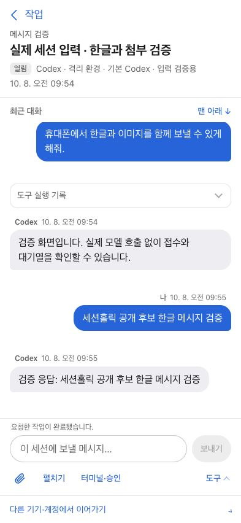

# 세션홀릭 - 에이전트 세션 매니저

[](https://github.com/RyanKwon87/sessionholic/actions/workflows/test.yml)

**Sessionholic — 내 AI 작업, 어디서든 이어서.**

여러 컴퓨터에서 돌아가는 Codex·Claude Code 세션을 작업으로 자동 정리하고, 필요한 답변과 최근 결과를 확인하며 대화를 이어가는 개인용 세션 매니저입니다. 작업 파일과 최근 대화를 다른 컴퓨터로 인계할 수 있습니다. 각자 자신의 컴퓨터에서 실행하는 self-hosted 앱이며, 서버와 대화 실행·제어는 macOS를 대상으로 합니다. Windows PC는 세션 조회와, 정확한 실행 서버가 확인된 Codex 세션의 텍스트·첨부 입력·터미널 연결·중단·종료, 저장된 Codex·Claude 대화의 터미널 재개(Claude는 그 터미널로 텍스트·첨부 경로 입력), 실행 중인 Claude 백그라운드 세션의 터미널 연결과 텍스트·첨부 경로 입력, `hosts.json`에 적은 새 세션 메뉴를 지원합니다.



위 화면은 실제 사용자 대화가 없는 이전 버전의 합성 검수 화면입니다. 현재 작업 보드와 집중 모드의 배치는 다를 수 있습니다.

## 할 수 있는 일

- 세션 탭으로 기본 진입하고 일반 세션·에이전트 세션을 분리하며 기기를 독립 배지로 표시
- 세션의 보드 표시 제목 수정·원래 제목으로 되돌리기. 새로고침 뒤에도 유지하며 수정한 제목과 원래 제목으로 검색
- 세션 목록은 답 필요 → 작업 중 → 최근 끝남(3시간) → 이전 순이고(보드에서 끝낸 세션은 바로 목록에서 정리), 각 묶음 안은 제목 가나다순이라 갱신돼도 자리가 바뀌지 않습니다(제목 수정으로 옮김, 이전 묶음만 최근에 연 순). 카드 메뉴의 목록에서 지우기는 목록에서 빼고, 답이 필요하거나 작업하는 동안에만 다시 보입니다. 답 필요 카드를 열면 질문을 불러와 바로 고르고, 목록에서 보낸 답장은 필요한 연결을 보드가 엽니다
- 답이 필요하거나 막 끝난 세션 중 아직 열어 보지 않은 것에 파란 점(읽음 기록은 보드에 저장돼 모든 기기에서 공유), 대화 입력창 도구 › 빠른 답장(집중 모드에서는 보내기 옆 버튼, 설정에서 문구 편집, 문구 선택 시 바로 전송). 같은 목록에 제목과 여러 줄 본문으로 된 저장 프롬프트도 함께 보입니다
- 빠른 답장 문구와 저장 프롬프트는 기기 간 공유하며, 새로고침·탭 닫기 뒤 같은 기기의 초안을 복원합니다. 긴 메시지는 전체 보기로 이어 읽고, 본문 검색으로 목록 세션의 저장된 대화를 찾습니다.
- 폰 알림: 답이 필요하거나 2분 넘게 걸린 작업이 끝나면 알립니다. 알림 서비스에는 내용 없는 신호만 보내고, 내용은 기기가 보드에서 직접 읽습니다(`--no-push`로 끔)
- 세션명·프로젝트 검색, 기기·프로젝트·시작 주체(세션을 연 봇별 포함) 필터, 기기 연결·기기 상태·사용량은 맨 위 헤더
- 음성 입력: 채팅 입력창과 터미널 입력줄의 마이크로 말한 내용을 바로 받아씁니다. 브라우저에 내장된 음성 인식(iPad·iPhone은 Apple, Android·컴퓨터의 Chrome은 Google 등 브라우저마다 다름)을 쓰며 보드가 따로 붙이는 모델은 없고, 자동으로 보내지 않습니다
- 기기 상태: 보드가 아는 맥·Windows 기기의 CPU·메모리·디스크·배터리·가동 시간(설정 `hardware`, 세션 없이 상태만 볼 기기는 `monitorOnly`)
- 웹보드 밖에서 시작한 세션도 원본을 확인해 응답 중단·실행 종료. Codex 앱 서버 세션은 종료·기록 보관 범위를 미리 안내
- 연결 끊김으로 닫힌 Codex 세션을 같은 기기·계정·ID로 다시 열기. 웹보드에서 직접 종료한 기록과 구분
- 봇 요청은 요청자·채널·권한·사용 범위를 별도 표시하고, 원래 봇의 실행 정책을 유지
- 직접 시작·에이전트 시작·출처 미확인 구분
- 실제 native CLI 터미널 연결, 여러 터미널 전환과 끊김 뒤 자동 재연결
- 휴대폰용 터미널 입력줄(한글·음성 입력), 두 줄 특수키(Esc·Tab·⇧Tab·Ctrl+C/J/U/X/L, 실제 키보드 배열의 방향키), 터치 스크롤
- Codex 세션에 메시지·이미지·파일을 바로 전송. 작업 중이면 CLI가 이어서 반영하며 보드가 따로 예약하지 않음
- Claude 백그라운드 세션에 웹에서 메시지 전송(보드가 연결한 터미널로 전달)
- 보낸 메시지의 첨부 표시와 업로드·전송 접수·기록 확인 상태 구분
- 작업 파일·Git 변경·최근 대화를 다른 기기의 새 작업 폴더와 세션으로 인계
- 읽기 쉬운 답변 서식, 답변·인용문·코드 복사
- 내용에 맞춰 늘어나는 입력창과 접기·펼치기, 한글 입력, 파일 선택, 브라우저가 허용하는 클립보드 붙여넣기
- PC·패드·폰의 대화 집중 모드, 같은 탭에서 대화를 다시 열 때 읽던 위치·보기 상태·초안·첨부 선택 복원
- 넓은 화면의 보드·상세 나란히 보기와 경계 조절, 키보드 조작과 동작 줄이기 지원
- 자기 Tailscale 네트워크에서 HTTPS로 접속

기기 이전은 실행 중인 프로세스의 메모리를 옮기는 기능이 아닙니다. 현재 응답 중단을 확인한 뒤 작업 파일과 대화 맥락을 전달합니다. 승인 대기 상태와 모든 대화 이력을 그대로 복제하지 않습니다. Claude는 보드가 연결한 터미널로 입력을 전달하므로 **백그라운드 세션**에서만 웹 입력을 지원합니다. 다른 터미널 앱에서 직접 실행 중인 Claude 세션은 그 터미널에서 입력해야 합니다. 상세 내용은 [지원 범위](docs/limitations.md)를 확인하세요.

별도의 작업 탭은 없습니다. 세션을 작업 카드로 모으던 화면은 내렸고, 보드는 세션 목록과 대화·터미널을 중심으로 동작합니다. `--auto-work`로 켜면 화면 밖에서 대화를 읽어 이전 작업 기록(`automatic-work.json`)을 계속 갱신하지만 그 기록을 보여 주는 화면은 없습니다. native 세션 수집 adapter는 Codex·Claude Code입니다. 별도로 등록된 봇 요청 원장의 메타데이터를 읽어 일반·에이전트 세션과 분리합니다. 모든 에이전트나 봇을 자동 발견하지는 않습니다.

집중 모드는 버튼으로 켜고 **집중 모드 해제**로 나옵니다. 패드·폰은 대화의 일반 영역을 짧게 탭해도 전환할 수 있습니다. 스크롤해서 접힌 도구는 맨 아래 도달·새 답변·오류만으로 다시 펼쳐지지 않으며, 질문과 전송 상태는 대화·입력창 곁에 남습니다.

세션 상세의 **제목 수정**, 또는 목록의 우클릭·길게 누르기 메뉴에서 표시 이름을 바꿀 수 있습니다. 이 이름은 보드에 저장하며 원본 CLI의 대화 제목은 그대로 둡니다. **원래 제목으로 되돌리기**로 지울 수 있습니다.

## 처음 실행하기

필요한 도구는 Python 3.9 이상, Git, SSH, tmux와 설치·로그인된 Codex 또는 Claude Code입니다. Python 외부 패키지는 필요하지 않습니다. Node.js는 프런트엔드 테스트에만 사용합니다.

macOS에서 tmux가 없다면 Homebrew로 설치할 수 있습니다.

```sh
brew install tmux
```

소스를 받은 뒤 저장소 루트에서 실행합니다.

```sh
git clone https://github.com/RyanKwon87/sessionholic.git
cd sessionholic
python3 scripts/sessionholic.py init
python3 scripts/sessionholic.py doctor
python3 scripts/sessionholic.py serve
```

브라우저에서 `http://127.0.0.1:8790/`를 엽니다. 최초 서버 실행 시 `~/.config/sessionholic/token` 파일에 생성된 접속 토큰을 로그인 화면에 입력하세요. 토큰은 본인 컴퓨터에서만 확인하고 공유하지 마세요.

`init`은 기존 설정을 덮어쓰지 않으며 다른 도구의 인증·Git·SSH 설정을 변경하지 않습니다. `doctor`는 로컬 도구, 설정 형식, 시작에 필요한 경로·권한을 검사합니다. 비밀값 읽기, 파일·권한 변경, SSH 접속, 모델 호출, 로그인 시도를 하지 않습니다. 기본 설정은 이 컴퓨터 한 대입니다.

처음에 목록이 비어 있다면 같은 OS 사용자로 Codex 또는 Claude Code에서 작업을 시작한 뒤 새로고침하세요. 터미널 연결과 직접 메시지 지원은 CLI의 종류·버전·세션 상태에 따라 달라집니다.

## 내 기기와 실행 환경 등록

| 파일 | 내용 |
| --- | --- |
| `~/.config/sessionholic/hosts.json` | 이 컴퓨터와 원격 SSH 기기 |
| `~/.config/sessionholic/config.json` | 프로필 라벨·프로젝트·선택적 실행 환경 |
| `~/.config/sessionholic/token` | 보드 접속 토큰 |
| `~/.local/state/sessionholic/` | 목록·대화 캐시, 터미널·요청·인계 상태 |
| `<state-dir>/goals.json` | 기존 직접 정리한 목표·연결 세션·변경 이력 |
| `<state-dir>/automatic-work.json` | 자동 작업·제한된 대화 발췌와 근거·세션 연결·사용자 교정·변경 이력 |
| `<state-dir>/session-labels.json` | 기기·계정·세션별 보드 표시 제목 |

[기기 예시](examples/hosts.json)와 [환경 예시](examples/config.json)를 참고해 본인 설정을 편집하세요. 예시의 SSH 별칭·폴더·프로필은 사용자가 이미 설정한 실제 값으로 바꿔야 합니다. 프로필을 적는 것만으로 native CLI 로그인이나 계정이 만들어지지는 않습니다. 계정 표시 이름은 확인된 로그인 신원을 뜻하지 않습니다.

원격 컴퓨터에도 Python·Git·tmux와 해당 CLI가 필요하며, 사용자가 먼저 SSH 연결과 native 로그인을 구성해야 합니다. 각 컴퓨터는 자기 홈의 설정과 인증을 사용합니다. 인증 파일을 기기 간 자동 복사하지 않습니다. 사용자 설정은 저장소 밖에 보관합니다.

환경 그룹을 지정했다면 원본 작업과 대상 프로필의 그룹이 일치해야 새 인계·기기 이전이 가능합니다. 실제로 같은 기존 세션에 다시 연결하는 동작은 유지합니다. 설정 스키마와 구성은 [아키텍처](docs/architecture.md)에 설명합니다.

기록은 남기고 계정의 새 실행만 중지하려면 버전 2 설정의 해당 `profiles[]` 또는 `profileRules[]`에 `"launchEnabled": false`를 지정하세요. 이 값은 기록을 수집하는 범위를 바꾸지 않습니다. `codexHomes.hide`는 기록도 목록에서 제외하는 별도 설정입니다.

## 휴대폰에서 접속하기

서버는 loopback에만 바인딩합니다. 휴대폰 접속은 본인의 Tailscale 네트워크에서 HTTPS Serve를 사용합니다. 기기별 설정은 [설치·운영 안내](docs/setup.md)를 참고하세요. 일반 인터넷 공개나 여러 사람의 공동 서버 운영은 이 버전의 지원 범위가 아닙니다.

브라우저를 닫아도 보드 전용 tmux 안의 실행은 유지됩니다. Codex 연결 닫기와 보드가 시작한 독립 CLI 실행 종료는 다릅니다. 닫기 전에 화면의 안내를 확인하세요. 설정의 **이 기기에 초안 보관**이 켜져 있으면 초안과 업로드가 끝난 첨부 참조를 이 브라우저에 최대 7일·50개까지 보관합니다. 전송 확인 중인 메시지는 기존 확인 번호로 상태를 읽으며 자동 재전송하지 않습니다. 터미널의 전송 미확인 입력과 업로드 중인 파일 선택은 자동 복원하지 않습니다. 잠금·인증 만료 또는 보관 설정을 끄면 보관한 초안을 지웁니다. 읽던 위치와 보기 상태는 현재 탭에서만 유지하며, 업로드한 파일은 실행 호스트에 별도로 남을 수 있습니다.

## 개발과 검증

```sh
python3 -m unittest discover -s tests -v
node --test tests/test_*.cjs
python3 scripts/check_public.py
```

테스트는 임시 홈·작업 폴더와 합성 세션을 사용합니다. 실제 모델 호출·개인 인증·실제 사용자의 응답 중단이 없는 테스트와 실제 기기 검증을 구분합니다. [검증 기록](docs/verification.md), [기여 안내](CONTRIBUTING.md), [보안 경계](SECURITY.md), [지원 범위](docs/limitations.md)를 확인하세요.

## 이용 조건

세션홀릭 자체 코드는 **Sessionholic Source Available License 1.0**으로 제공합니다.

- 개인 사용, 회사 내부 업무와 고객 업무 수행에 사용·수정 가능
- 라이선스·저작권 고지를 유지하고 같은 조건으로 무료 재배포 가능
- 세션홀릭 자체 또는 수정판의 재판매·유료 호스팅/관리 서비스 제공 금지. 해당 사용에는 별도 서면 허가 필요
- 세션홀릭을 내부 도구로 사용해 만든 일반 업무 산출물은 판매 가능

이는 상업적 재배포를 제한하는 **소스 공개(source-available)** 프로젝트이며 OSI 오픈소스 라이선스로 표시하지 않습니다. 별도 작성한 이용 조건의 원문은 [LICENSE](LICENSE)이며, 위 설명은 원문을 대체하지 않습니다. 포함된 xterm 등의 외부 구성요소에는 [원래 라이선스](THIRD_PARTY_NOTICES.md)가 계속 적용됩니다.
