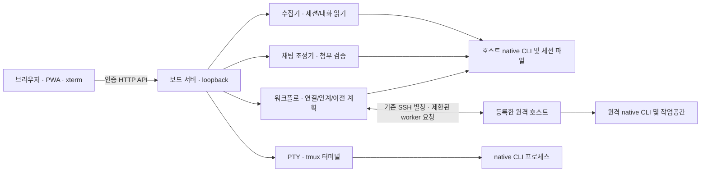

# 아키텍처

세션홀릭(Sessionholic)은 개인이 관리하는 macOS 호스트의 Claude Code·Codex CLI 세션을 발견하고, 선택한 세션의 상태·대화·실행 위치를 이어주는 self-hosted 애플리케이션입니다. 앱 자체가 모델을 실행하거나 native CLI 인증을 소유하지 않습니다. 브라우저는 로컬 보드 서버와 통신하고, native 세션·파일·CLI 명령은 이를 소유한 호스트에서 처리합니다.

## 요청 경로

1. `web/`은 정적 모바일·데스크톱 화면입니다. 목록 조회, 세션 상세, 직접 메시지, 실행 계획과 터미널 입출력을 인증된 서버 API에 요청합니다. 대화와 터미널 출력은 서비스 워커의 오프라인 캐시에 넣지 않습니다.
2. `server.py`는 loopback 전용 HTTP 서버, 브라우저 인증, 세션 상태 캐시, `Board`, `Workflow`, `Chat`, `TerminalManager`를 구성합니다. 연결된 화면의 요청에 따라 등록 호스트를 병렬로 수집하고, 끝난 호스트부터 상태에 반영합니다. 같은 호스트는 한 번에 하나만 수집합니다. 연결에 실패한 호스트는 2분·5분·15분으로 늘어나는 간격이 지난 뒤 다시 수집하며, 수동 새로고침은 즉시 다시 확인합니다. 수동 새로고침의 일회성 수집은 Codex가 대화 기록 파일을 다시 훑어 목록 정보를 바로잡게 합니다(`snapshot --full`).
   - 실시간 연결(`/api/events`)을 보는 화면이 하나라도 있으면 호스트마다 상주 수집기(`collector.py watch`) 하나를 띄웁니다. 로컬은 직접 실행하고, 원격은 기존 SSH 공유 연결 위의 세션 하나로 실행합니다. 원격에는 `<바이트 길이>\n<프로그램>`을 표준 입력으로 보내 파일을 남기지 않고, 이어지는 표준 입력은 10초마다 보내는 `ping`과 수동 새로고침의 `refresh`에 씁니다. 수집기가 보낸 전체 스냅샷은 일회성 수집과 같은 상태 갱신 경로를 타므로, 내용이 실제로 바뀔 때만 `version`이 오르고 `snapshot` 이벤트가 나갑니다. 마지막 화면이 끊기고 60초 뒤 멈추고, 서버를 끌 때도 정리합니다. 상주 수집기가 돌아가는 동안에는 화면의 안전망 새로고침이 일회성 수집을 일으키지 않습니다. 상주 수집기가 끝나거나 30초 동안 아무 줄도 보내지 않으면 일회성 수집으로 한 번 대신하고, 재시작은 일회성 수집과 별도인 5초·30초·2분·10분 간격으로 늦춥니다. 시작 뒤 1분 안에 끝나는 일이 세 번 이어지면 15분 동안 다시 띄우지 않고, 일회성 수집이 실패해 멈춘 호스트는 일회성 수집이 성공한 뒤에 다시 띄웁니다. 상주 수집기 결과는 호스트 잠금 없이 반영되며, 그보다 먼저 시작한 일회성 수집 결과는 덮어쓰지 않습니다. `--no-live`로 끌 수 있습니다.
   - 공개 정적 자산은 (이름, mtime, 크기) 기준으로 메모리에 캐시하고, gzip을 받는 클라이언트에는 1,024바이트 이상인 html·js·css·svg·manifest를 압축해 보냅니다. ETag와 `If-None-Match`로 304를 돌려주고, `?v=<내용 해시 8자>`가 현재 파일과 맞을 때만 1년 immutable 캐시를 허용합니다. `index.html`은 보낼 때 자산 해시 목록을 `sessionholic-assets` meta에 채우고 `src`·`href`에 버전 쿼리를 붙이며, `index.html`·`sw.js`는 항상 다시 확인합니다. JSON API 응답도 1,024바이트 이상이면 같은 조건으로 압축하고 `no-store`를 유지합니다.
   - `/api/events`(`events.py`)는 Server-Sent Events로 스냅샷 `version` 변경과 구독한 대화의 상태 digest 변경을 알립니다. 스냅샷 `version`은 호스트 상태가 실제로 바뀔 때만 오릅니다. 같은 대화는 구독자 수와 관계없이 감시자 하나가 기존 대화 상태 조회 경로(2초 캐시 포함)로 읽습니다. 작업 중이거나 내용이 바뀌었거나 보드에서 메시지 전송·질문 응답이 성공하면 2초 간격이고, 변화 없는 조회가 이어지면 5·10·20·30초로 늘린 뒤 30초를 유지합니다. 오류 뒤에는 10초 이상, 현재 유휴 간격보다 짧지 않게 기다립니다. 감시자는 마지막 구독이 끊긴 뒤 10초에 멈춥니다. 연결은 8개까지 받고 15초마다 heartbeat를 보내며, 스트림은 수집 잠금을 잡지 않고 서버 종료를 막지 않습니다.
   - 보드 터미널 목록이 바뀌면 `event: terminals`(data `{"version": <int>}`)를 보냅니다. hello에는 현재 `terminalsVersion`을, `/api/terminals` 응답에는 목록을 읽기 직전의 `version`을 싣습니다. 생성·닫기·attach·detach는 `TerminalManager`가 직접 알리고, tmux 세션이 스스로 끝난 경우는 스트림이 하나라도 열려 있을 때만 감시자 하나가 5초마다 `terminals.list()`의 살아 있는 터미널 집합을 비교해 찾습니다(오류 뒤 10초, 마지막 스트림이 끊기고 10초 뒤 멈춤). 아무도 보지 않는 동안에는 읽지 않고, 다시 연결되면 첫 조회에서 그사이 끝난 터미널을 알립니다. 화면은 이 이벤트를 300ms 묶어 `/api/terminals`를 다시 읽고, 같은 기기의 열기·닫기는 응답 직후 목록 카드와 대화 머리말에 반영합니다. 실시간 연결이 없으면 일반 새로고침이 1분 넘은 터미널 목록을 다시 읽습니다.
3. `collector.py`는 호스트에서 Claude Code·Codex의 세션 상태와 최근 대화를 읽습니다. Codex home이 여러 개면 home마다 별도 daemon 연결로 최대 4개를 동시에 읽고, 결과는 home 순서대로 합칩니다. 메시지는 4,000자에서 자르고, 잘린 행에만 `truncated`와 원래 글자 수 `fullLength`를 붙입니다. 원격 조회는 기존 SSH 별칭을 통해 수집기 코드를 표준 입력으로 전달합니다. 이는 사용자의 SSH 연결과 원격 native CLI 설치·로그인을 전제로 합니다.
   - Codex 목록(`thread/list`)은 `useStateDbOnly`로 상태 DB에서만 읽습니다. 이 인자에 오류 응답을 주는 Codex는 그 home만 인자 없이 한 번 더 읽습니다. 다른 Codex home을 가리키는 심볼릭 링크 home은 같은 daemon을 두 번 읽지 않도록 건너뜁니다.
   - daemon 소켓이 없는 home(보관용 `.codex-router/` 제외)은 가장 높은 번호의 `state_<n>.sqlite`를 읽기 전용(`mode=ro`)으로 열어, 보관하지 않은 대화형(`cli`·`vscode`) 스레드를 최신순으로 목록에 넣고 `appServer: "off"`로 표시합니다. 그 대화 읽기는 `app_server_off` 코드로 거절하고, 화면의 "앱 서버 켜기"(`POST /api/app-server`)가 그 기기에서 해당 계정의 실행 환경으로 `codex app-server daemon start`를 실행합니다. 이후 그 계정의 Codex 세션은 이 daemon을 함께 씁니다. 실행 환경에 격리 변수가 없을 때만 사용자의 `SSH_AUTH_SOCK`를 넘깁니다.
   - `watch` 모드는 Codex home마다 daemon 연결 하나를 유지합니다. 모든 연결에 방송되는 스레드 목록 알림(`thread/started`·`thread/status/changed`·`thread/name/updated`·`thread/archived`·`thread/unarchived`·`thread/closed`·`thread/deleted`)을 받으면 0.25초 묶어 상태 DB 목록을 다시 읽습니다. 스레드를 구독(`thread/resume` 등)하지 않으므로 Codex 실행 수명은 바뀌지 않습니다. 알림이 없어도 Codex는 5초마다 상태 DB로, 120초마다 파일 재검토 목록으로 읽고, daemon이 재시작되면 home의 소켓 링크로 다시 연결합니다. Claude Code는 세션 등록 파일·백그라운드 작업 상태·대화 기록 파일의 크기와 수정 시각만 1초마다 확인해, 등록 정보가 바뀌면 `claude agents`를 다시 부르고(최소 2초 간격, 변화가 없어도 60초마다) 기록만 늘면 미리보기만 다시 읽습니다. tmux는 10초마다 읽습니다. 내용이 바뀔 때만 전체 스냅샷을 JSON 한 줄로 내고, 상태·제목·행 변경은 1초, 시각·미리보기만 바뀐 경우는 5초 간격으로 묶습니다. 10초마다 heartbeat를 내고, 표준 입력이 닫히거나 30초 동안 아무 줄도 받지 못하면 스스로 끝납니다. 같은 보드의 상주 수집기는 `/tmp/sessionholic-watch-<uid>/<보드 ID>.lock` 잠금으로 호스트마다 하나만 돌고, 잠금을 35초 안에 얻지 못하면 `busy`를 내고 끝납니다.
4. `Workflow`는 선택된 세션·계정·호스트를 다시 확인하고 연결 계획을 만듭니다. 같은 native 세션 연결, 최근 맥락을 전달하는 새 native 실행, 새 작업 폴더를 준비하는 호스트 간 이전은 서로 다른 경로입니다.
5. `Chat`은 메시지·첨부 요청을 원본 세션이 있는 호스트로 전달하고 결과를 확인합니다. `native_chat.py`는 호스트별 native capability를 검사하고, `attachments.py`는 실제 세션의 작업 경로 안에서 파일을 안전하게 저장·검증합니다.
6. `terminal.py`는 서버가 검증한 native CLI 명령을 전용 tmux 세션과 PTY에서 실행합니다. 브라우저의 xterm은 해당 PTY에 연결된 터미널 화면입니다. 브라우저 연결을 닫는 것과 CLI 실행을 종료하는 동작은 별도입니다.
7. `terminal_input.py`는 PTY 입력 전에 요청 해시와 미확인 상태를 SQLite에 저장합니다. 쓰기를 마친 경우만 접수 상태로 바꾸며, 미확인 요청은 재시작 뒤에도 재전송하지 않습니다. 터미널 원문은 이 기록에 넣지 않습니다.

## 세션 전환 모델

- **연결:** 같은 호스트·native 계정·세션 ID의 기존 프로세스에 연결합니다.
- **인계:** 원본 최근 대화와 작업공간 맥락을 기록하고 대상 native CLI로 새 프로세스를 시작합니다. 기존 프로세스, 실행 turn, 승인 대기 상태를 다른 프로세스에 옮기지 않습니다.
  - 원격 기기 안의 인계(같은 원격 기기의 다른 에이전트·계정)는 그 기기의 helper가 실행합니다. 보드는 원본 대화를 읽어 `stage_handoff` 요청 하나로 보냅니다. 원격 helper는 자기 규칙으로 대상 프로필과 실행 환경 경계를 다시 판정하고, 인계 문서를 쓰고, 첫 지시를 전달(Codex는 app-server `turn/start`, Claude는 `--session-id`)한 뒤 실행 정보를 비공개 폴더(`remote.transfersDir/handoffs/<요청 해시>/`, 0700·0600)에 저장합니다. 새 native 세션 정보는 보드에 돌려줘 터미널 기록에 남깁니다. 보드 터미널은 SSH로 helper의 `handoff <요청 해시>` 단계를 실행하고, 이 단계는 저장한 실행 정보를 한 번만 읽고 지운 뒤 대상 CLI를 exec합니다.
  - 같은 요청은 한 번만 처리합니다. 보드는 실행 전에 상태 폴더 `handoffs/<요청 해시>.json`을 남기고, 원격은 같은 요청 해시를 다시 받으면 거절합니다. 첫 지시 전달 기록은 실행 경로(원본·대상) 단위로 원격에 남아, 터미널이 붙기 전에 실패한 경로를 다시 실행하면 같은 Codex 스레드를 다시 열고 첫 지시를 반복하지 않습니다.
- **기기 간 이전:** 대상 계정을 다시 확인한 뒤 원본 응답을 중단하고 선택된 작업공간과 최근 대화를 새 목적 폴더로 복사합니다. 파일을 검증하고 대상 호스트에서 새 native 세션을 준비합니다. 원본 폴더·대화 기록은 남습니다. 실행 프로세스 자체를 이동하는 기능은 아닙니다.

원격 연결·이전은 별도 daemon을 설치하지 않습니다. 필요한 제한된 helper 모듈을 표준 입력으로 전송하며, 원격 호스트에는 SHA-256으로 확인한 버전 파일을 개인 상태 디렉터리에 둘 수 있습니다. 요청은 먼저 helper의 SHA-256만 보내고, 원격에 같은 해시의 파일이 없거나 손상됐으면 원격이 아무것도 실행하지 않고 "런타임 필요"를 응답합니다. 이때만 helper 전체를 보내 해시 확인 뒤 원자적으로 설치합니다. 서버는 호스트별 설치 확인 여부를 메모리에만 기억합니다. 사용자 native CLI의 인증 파일이나 설정 전체를 복사하지 않습니다.

## 로컬 설정 계약

비밀값이 아닌 호스트별 설정은 `~/.config/sessionholic/config.json`에 둡니다. `settings.py`는 버전 1 JSON의 `profiles`, `projects`, `environments`만 허용하며, 파일이 없으면 빈 profile/project와 기본 환경을 사용합니다. 계정 라우터 파일은 버전 2의 `agentRouter`를 지정했을 때만 읽기 전용으로 읽고, 변환하거나 쓰지 않습니다.

- `profiles`: `agent`, native 계정 경로 `home`, 사용자 표시 `label`, 실행 환경 `environment`를 지정합니다. 지원 agent는 `codex`와 `claude`입니다. Claude는 기본 `.claude` 환경만 지원하고, Codex profile 경로는 허용된 `.codex` 형식이어야 합니다.
- `projects`: 프로젝트 식별자·표시 이름·절대 또는 홈 상대 `root`·실행 환경을 지정합니다. 작업 경로가 여러 프로젝트 root에 속하면 가장 구체적인(긴) root가 적용됩니다.
- `environments`: 실행 환경의 label과 허용된 환경 변수만 지정합니다. 키는 `GH_CONFIG_DIR`, `GIT_CONFIG_GLOBAL`, `GIT_CONFIG_SYSTEM`, `GIT_CONFIG_NOSYSTEM`, `GIT_SSH_COMMAND`, `GIT_SSH`, `SSH_AUTH_SOCK`로 제한됩니다. 임의 키·환경변수 전체를 주입하는 기능이 아닙니다.
- 작업공간이 project root에 매칭되지 않으면 native profile의 `environment`를 사용하고, 지정이 없으면 `default`를 사용합니다. 새 실행 또는 기기 이전에서는 실제 출발 작업의 환경과 선택한 대상 profile의 환경 이름이 맞아야 합니다.
- 표시 label은 로그인 신원 검증 결과가 아닙니다. 설정에는 비밀값을 넣지 말고, 특히 SSH·Git 관련 경로와 명령은 사용자 권한으로 실행되는 설정으로 취급합니다.

`"version": 2` 파일은 위 필드에 더해 다음 선택 필드를 받습니다. 빠진 필드는 버전 1 동작 그대로이고, 형식이 틀리면 버전 1처럼 기동·수집·실행을 멈춥니다(fail closed).

- `environments.<g>`: `boundaryGroup`(경계 비교에 쓸 다른 그룹, 한 단계), `scope`·`description`(실행 설정 화면의 묶음 이름과 설명). 환경 변수 허용 키에 `CMUX_CODEX_HOOKS_DISABLED`가 추가됩니다(버전 1에서도 허용).
- `profileRules`: `[{agent, homePrefix, environment, label, suffixLabel}]`. 목록에 없는 홈을 접두사로 분류합니다. 접두사는 이름 경계(`-`·`/`)에서만 맞고, 처음 맞는 규칙을 씁니다. `suffixLabel`이면 접두사 뒤 이름이 표시 이름이 됩니다.
- `profiles[]`: `placeholder`(폴더가 없어도 사용 불가로 표시), `project`(이 홈의 세션을 프로젝트에 연결), `title`(전체 표시 이름).
- `projects[].match: "component"`: `root`를 폴더 이름 하나로 보고, 해석한 작업 경로의 어느 구성요소든 같으면 그 환경을 씁니다. 긴 root 매칭이 먼저이고, 이름표에는 쓰지 않습니다.
- `boundary`: `{agents, claude, priority}`. `agents`에 있는 대상 에이전트만 경계를 검사합니다(기본 둘 다). 빠진 에이전트는 원본 환경 변수로 실행합니다(`claude: "inherit-source"`). `priority` 그룹은 신호(원본 홈의 profile·규칙, 경로 구성요소·root project)가 하나라도 있으면 다른 판정과 이전받은 작업공간의 기록보다 먼저 적용되고, 이때 기록은 읽지 않습니다. 없으면 이전받은 작업공간은 기록만 따릅니다.
- `legacy.sourcePersonal`: `{"true": g, "false": g}`. `sourceEnvironment`가 없는 옛 이전 기록의 boolean을 읽기만 합니다. 둘 다 없거나 boolean이 아니면 거절합니다.
- `codexHomes`: `allowSymlinks`(링크 홈 수집), `excludeSuspended`(계정 정책의 중단 계정 `.codex-<a>`·`.codex-personal-<a>` 수집 제외), `requireMarker`(로그인·설정·소켓 파일이 있는 폴더만 실행 프로필로 표시), `hide`(쓰지 않는 홈 이름 목록. 수집과 실행 대상에서 모두 뺍니다).
- `agentRouter`: `{projectsFile, workspacesRoot, accountPolicy}`. 수집기의 프로젝트 이름표, 작업공간 루트, `.codex-router/<hash>` 홈의 (프로젝트, 계정) 이름표에만 씁니다. 계정 정책은 키 이름만 읽습니다.
- `tmux`: `{titleOption, taskOption}`. 기존 tmux 세션의 사용자 옵션을 제목·작업으로 표시합니다.
- `transfer.agentConfig`: `"exclude-private"`(기본, `.claude`·`.codex*`의 개인 상태만 제외) 또는 `"exclude-all"`(이 이름의 폴더·파일 전체 제외).
- `attachments.gitExclude`: 기본 `true`. `false`면 업로드 때 저장소의 `.git/info/exclude`를 쓰지 않습니다.
- `usage`: 보드 호스트의 사용량 도우미(`usage.py`). `provider: "helper"`, `resources`·`python`·`path`, Codex(`codex`, `codexHelper`, `codexAccounts: [{key, label}]`)·Claude(`claude`, `claudeHelper`) 중 하나 이상, `intervalSeconds`(기본 300)·`manualIntervalSeconds`(기본 20). 없으면 `/api/usage`는 404이고 화면은 사용량을 숨깁니다.

- `launcher`: `{command, label, cwd}`. 목록의 "새 세션"이 이 기기의 터미널에서 여는 실행 명령입니다. `command[0]`은 절대 경로나 `~/` 경로이고, `label`(기본 "새 세션")은 화면 이름, `cwd`(기본 홈 폴더)는 시작 폴더입니다. 보드는 명령을 열기만 하고, 프로젝트·에이전트·계정 선택과 그 검사는 실행 명령이 맡습니다. 원격 기기는 그 기기의 설정으로 실행하며, 환경 변수는 일반 터미널 변수(`PATH`·`LANG`·`TERM` 등과 사용자의 `SSH_AUTH_SOCK`)만 넘깁니다. 실행 명령이 `  1. 이름` 줄과 `선택:` 같은 입력 줄로 번호 메뉴를 보이면, 화면은 그 메뉴를 버튼으로 보여 주고 누르면 번호와 Enter를 입력합니다. 없으면 "새 세션"은 숨겨집니다.

기기 목록·SSH 별칭과 HTTP 서버 실행 옵션은 설치 안내의 예시 설정을 따릅니다. 외부 주소, 호스트, 계정, 토큰을 코드나 문서 예시에 고정하지 않습니다.

## 상태 보관

세션 캐시, 읽은 대화, terminal 등록, 요청 중복 방지 기록, 이전 진행 기록은 사용자의 지정 상태 디렉터리에 보관됩니다. 첨부 파일은 실행 호스트의 실제 작업 디렉터리 아래 `.sessionholic-attachments/`에 저장되며, 이전 파일 선택에 포함될 수 있습니다. 데이터는 계정 간이나 기기 간에 자동 동기화되지 않습니다.
