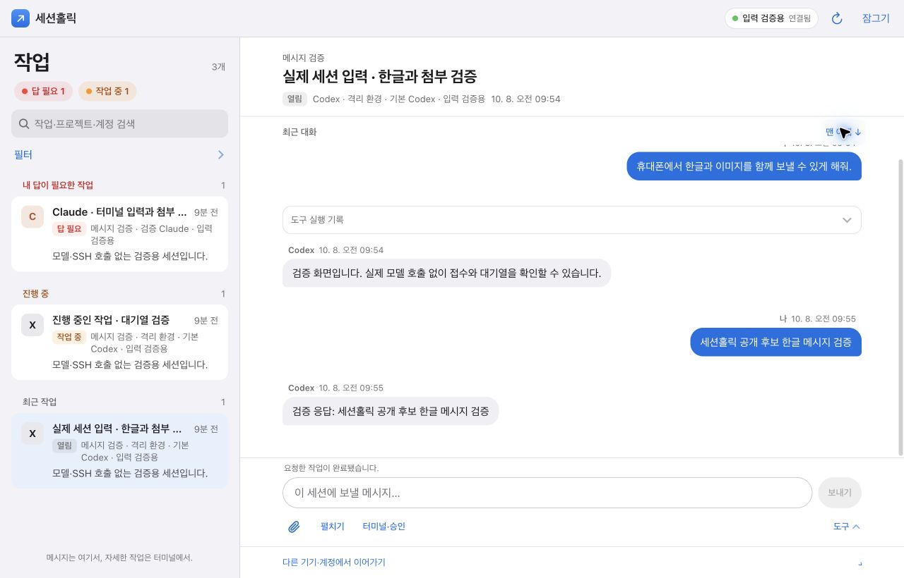

# 공개 후보 검증 기록

최근 기록 추가: 2026-10-12 KST(최초 2026-10-08). 이 문서는 최초 공개와 후속 개선에서 검수한 범위를 기록합니다. 실제 계정·모델 호출이나 여러 기기의 호환성을 보증하지 않습니다. 아래 날짜별 수치·화면은 당시 버전의 기록이며 현재 변경 전체의 검증 결과를 대신하지 않습니다.

## 2026-10-12 외부 세션 관리·연결 재개·봇 요청 분리

macOS Python 3.9.6 전체 915개와 JavaScript 전체 319개가 통과했습니다. 공개 파일 검사 110개에서 발견 사항이 없었습니다. 배포 도구의 설치·원복·빌드·카나리 합성 검증 17개도 통과했습니다.

- 외부 Codex의 정확한 실행 대상 확인, 종료 미리보기·실행 직전 재검증·중복 요청 방지·결과 미확인을 검사했습니다. CLI 프로세스 종료와 native 세션 보관의 범위가 다르며, 하위 에이전트까지 요청하는 동작은 확인 화면에 명시합니다. 실제 사용자 세션은 종료하지 않았습니다.
- 웹보드에서 직접 닫은 기록과 연결이 자연스럽게 끝난 기록을 구분합니다. 저장된 UUID·계정·작업 폴더가 일치하는 같은 대화의 재개, 미리보기 뒤 종료된 경합, 앱 서버와 대화 조회가 모두 실패해도 재개 안내 유지, 초안 보존을 검사했습니다. 재개는 새 메시지나 새 대화를 만들지 않습니다.
- Windows의 stdin 전용 native RPC, 정확한 endpoint·프로세스 시작 시각 확인, 텍스트 전송의 단일 실행·receipt, 같은 세션 터미널 계획, 계정·기기 경계와 첨부 차단을 검사했습니다. Windows 원본 경로가 있는 터미널 메타데이터는 실제 격리 echo tmux 생성과 서버 재로딩을 통해 보존을 확인했습니다.
- 봇 원장은 명시된 출처마다 읽기 전용·최대 100건·SQLite 실행 기한을 적용합니다. 팀 봇의 암호화된 본문에 접근하지 않음, 기존 시간·고유 인덱스 사용, WAL 보조 파일 미생성, 출처별 캐시·실패 격리·마지막 연결 근거 유지, 원래 계정에 실재하는 native ID만 연결함을 검사했습니다. 봇 세션의 직접 입력·터미널·종료 차단은 배포 전에 이미 열린 터미널에도 적용합니다.
- 합성 브라우저 PC 1440, 패드 820, 폰 390, 좁은 폰 320, WebKit 폰 390에서 재개·기기 연결 재확인·직접 종료 구분과 세 분류를 검수했습니다. 봇 요청자·채널·권한·범위, 확인되지 않은 항목, 출처 오류, 명시 새로고침, 최초 일반 목록에서 확인된 봇 세션 제외를 확인했습니다. 실제 iOS 키보드·터치 하드웨어 검증은 포함하지 않습니다.
- 실제 원격 읽기에서는 Mac의 대상 대화가 재개 가능한 상태이며, Windows의 기존 Codex가 입력 가능 상태이고 같은 세션 터미널 계획을 만들 수 있음을 확인했습니다. 원격 입력·종료·터미널 실행은 하지 않았습니다. 봇 원장 세 출처도 읽었으며 요청 수는 조회 시점에 따라 달라집니다. 이 검증은 실제 모델 turn이나 모든 CLI 버전의 호환성을 보증하지 않습니다.

## 2026-10-12 일반·에이전트 세션 분리 검증

- JavaScript 전체 305개, Windows 수집 29개와 호스트 통합 20개를 통과했습니다. 기본 일반 목록, 명시 agent 분리, unknown 보존, 시작 주체 필터와 분류 동기화, 다른 분류 검색 결과 이동, 대화 직행과 기존 스크롤 보존을 확인했습니다.
- 별도 합성 보드의 PC 1440, 패드 820, 폰 390, 좁은 폰 320, 다크 폰, WebKit 폰 6조합에서 일반 5개·에이전트 1개 분리, 키보드 전환, 검색·필터, 초안 복귀와 가로 넘침 없음을 확인했습니다. 실제 native 입력은 보내지 않았습니다.
- Windows의 빈 thread_spawn·other 형식도 Mac과 같은 native subagent 근거로 보존합니다. 실제 PC 읽기 한 번에서 기록 83개 중 확정 agent 5개와 unknown 78개를 확인했습니다. 실행 방식이나 부모 참조만으로 주체를 추정하지 않습니다.

## 2026-10-12 자동 작업 화면 후속 검증

최종 통합 검증은 macOS Python 3.9.6 전체 824개와 Node.js 전체 300개가 통과했습니다. 공개 파일 검사 103개에서 발견 사항이 없었고 별도 Mini 설치·원복 fixture 9개도 통과했습니다. 전체 실행에서 드러난 이전 파일 이전 테스트의 native 서버 실행 누출은 fixture 경계를 가짜 실행으로 고치고, 테스트 소유 도우미가 모두 끝난 뒤 임시 폴더를 정리하도록 검증했습니다.

Windows 수집기는 실제 연결된 PC에서 읽기 전용 snapshot으로 Codex 37개·Claude 46개 기록을 읽었으며, 그 시점에 native 실행 근거가 확인된 세션은 각각 1개·2개였습니다. 나머지 기록은 실행 중으로 추정하지 않습니다. 확인된 Codex 대화 한 건에서 48개 메시지와 native 상태를 읽었고 입력·중단·새 프로세스 서버 시작은 하지 않았습니다. Windows 긴 경로 표기와 업데이트 뒤 이름이 바뀐 Claude 실행 파일은 정확한 기기·PID·생성 시각·허용 경로를 함께 검증합니다. 이 수치는 해당 조회 시점의 기록입니다.

Windows 지원 표시의 후속 합성 검증은 `runtimeKnown:false`가 이전 live phase로 승격되지 않으며 목록·상세에서 `실행 확인 전`으로 표시되는지 확인했습니다. Chromium 폰 390×844의 클라이언트 메모리에 가짜 Windows 기록을 추가해 `작업실 PC` 배지, 온라인일 때 실행 미확인과 기기 오프라인을 혼동하지 않는 표시, 오프라인일 때 별도 이전 정보 표시를 확인했습니다. 이 검수는 실제 PC나 Windows 세션을 조회하지 않았습니다.

최신 합성 서버에서 Chromium PC 1440×1000, 패드 가로 1180×820·세로 820×1180, 폰 390×844 라이트·다크, WebKit 폰 390×844의 여섯 조합을 검수했습니다. 세션 기본 탭과 기기 배지, 상세 헤더 폭, 집중·초안 복귀, 자동 카드 5개, 대화 직행, 제목·고정 실행 취소, 관리 미리보기, 보관·복원 흐름은 6/6 통과했습니다. PC 합성 응답 중단은 확인 전 무전송, 중복 클릭에도 제어 POST 1회, 확인된 결과 표시를 검증했습니다. 브라우저 pageerror는 0건이며 실제 모델·SSH·native 제어는 호출하지 않았습니다. 시트 공통 스타일 누락을 수정한 후 관리 창만 같은 여섯 조합에서 재검수했고 테마·테두리·모바일 폭·재개방 핸들을 확인했습니다. 캡처는 `.impeccable/review/auto-work/`에 저장했습니다. 실제 iPad·폰의 키보드와 터치 하드웨어 검증은 포함하지 않습니다.

세션 기본 진입, 별도 기기 배지, 상세 헤더의 제목 폭 확보와 자동 작업 갱신을 반영한 뒤 `node --test tests/test_frontend.cjs tests/test_goals_frontend.cjs tests/test_session_control_frontend.cjs` 283개를 통과했습니다. 새 제어 테스트 8개는 정확한 대상 미리보기, 확인 전 무실행, 중복 클릭 단일 전송, 응답 유실·CSRF 만료 무재시도, 오래된 미리보기·인증 세대 차단, 보관과 원본 제어 분리를 검증합니다. DOM 합성 검증이며 실제 기기 레이아웃 검증을 대신하지 않습니다.

`tests/uiux_preview_fixture.py`는 수동 목표 저장 없이 실제 자동 관측 저장소에 합성 메시지를 넣습니다. 새 임시 상태 폴더에서 답변 필요·진행 중·결과·대기·오프라인 카드 5개, 부모와 하위 워커 한 묶음, 제어 미리보기 무실행 및 같은 requestId의 중복 제어 한 번 실행을 확인했습니다. HTTP 루프와 관측 스레드를 가로채고 in-memory fake만 사용했으며 모델·SSH·실제 native 제어는 호출하지 않았습니다. 브라우저 검수는 별도 최신 캡처를 근거로 판단합니다.

작업을 직접 등록하던 화면을 세션 기반 자동 작업으로 전환한 후 `node --test tests/test_goals_frontend.cjs`의 합성 프런트엔드 테스트 32개를 통과했습니다. 아래의 앞선 작업 보드 검증은 이전 수동 입력 흐름을 포함한 당시 기록이며 새 자동화 구현의 전체 검증 수치로 합산하지 않습니다.

- 작업 등록 폼 없이 일 시작하기가 기존 세션 시작 hook을 호출하고, 기본 화면이 답변 필요·진행 중·최근 결과 순으로 구성되는지 확인했습니다. 대기·이전 작업은 접히고 칸반은 선택 보기입니다.
- 카드가 답변이 필요한 연결 세션을 우선 열며 관리 hook에 같은 세션을 전달하는지, 부모 워커를 접는지, 자동 필드를 덮지 않고 제목만 수정하는지 확인했습니다.
- 작업 묶기의 두 revision, 세션 분리의 정확한 기기·계정 참조, 병합 원본 중복 제외, 추정 질문 표시를 검사했습니다. 응답 도착과 완료 근거 확인, 오프라인 연결과 작업 상태를 구분합니다.
- 제목 교정 충돌·늦은 응답·잠금 후 응답 무시·고정 실행 취소·대화 뒤/앞 이동·시트 취소 초점 복귀·갱신 후 같은 그룹 순서와 펼침 유지를 회귀 검증했습니다.
- 이 기록은 합성 DOM과 가짜 API 검증입니다. 자동 관측자의 실제 호스트 조회, native 응답 중단·실행 종료, 브라우저 시각 검수·모바일 실기 검증을 수행했다는 뜻은 아닙니다. 통합 검증은 해당 실행 결과를 별도로 기록합니다.

## 2026-10-12 작업 보드·시작 주체·집중 모드 검증 범위

이번 변경은 macOS Python 3.9.6에서 Python 전체 668개, Node.js 26.7.0에서 JavaScript 전체 278개 테스트를 통과했습니다. 공개 파일 검사 90개에서 발견 사항은 없었습니다. 이후 세부 수정은 해당 회귀를 다시 확인했습니다. 검증 명령은 다음과 같습니다.

```sh
python3 -m unittest discover -s tests -v
node --test tests/test_*.cjs
python3 scripts/check_public.py
```

- 목표 저장/API 검증 대상은 다중 세션 연결, 완료 조건·근거와 대기 이유, 작업 상태와 세션·연결·receipt 상태의 독립, revision 충돌, 최근 100개 이력, 파일 권한·링크·손상·동시 쓰기, 인증·Origin·CSRF, 확인된 인계만의 목표 연결입니다. 합성 세션과 임시 상태 폴더를 사용합니다.
- 시작 주체·실행 정책의 관련 테스트는 이번 작업에서 통과했습니다. Codex RPC/DB의 구조화 subagent 보존, client 모드로 시작 주체를 추정하지 않음, 부모·현재 워커·시작 주체 분리, offline source 확장, 구버전 필터 fallback, `launchEnabled`와 중단 계정 실행 거부, 기록 보존과 환경 경계를 포함합니다. 실제 자격증명을 읽거나 모델 turn을 실행하지 않았습니다.
- 프런트엔드 검증 대상은 작업 검색·필터·부모 세션 묶음, 상태 이동과 완료 입력, 목표 수정 충돌·실행 취소, PC의 명시 집중 버튼과 패드·폰의 안전한 탭, 직접 스크롤 뒤 숨김 유지, 바닥 도달·새 답변·질문·오류의 숨김 상태 비변경, 읽던 위치·초안·첨부 선택 복원과 잠금 시 초기화입니다. 한글 조합·선택·코드·첨부·길게 누르기와 집중 모드가 충돌하지 않는 경로도 포함합니다.
- 운영과 분리한 합성 개발 보드에서 Chromium의 PC(1440×1000)·패드 가로(1180×820)·패드 세로(820×1180)·폰(390×844), 라이트·다크, 시스템 동작 줄이기로 화면을 검수했습니다. WebKit의 폰 크기에서도 목표 편집 시트·초점 복귀·목록/칸반 전환, 집중 모드와 뒤/앞 이동·초안 유지·검색을 검증했습니다. 에뮬레이션 화면은 실제 iPad Safari·폰의 키보드·터치·잠금 복귀 검증과 구분합니다. 이번 변경의 실제 iPad Safari·폰 하드웨어 검증은 아직 완료 기록이 없습니다.
- 실제 브라우저에서 목표 생성·대기 이유·완료 근거·고정·다중 세션 연결·마우스 드래그·검색 0건·보관/실행 취소를 검증했습니다. 검증 목표만 생성하고 보관했으며 기존 합성 목표 5개는 변경하지 않았습니다.
- 클라이언트에만 합성 장문 20행을 넣은 실제 DOM 검증 18개도 통과했습니다. PC·터치 화면에서 집중 토글의 기준점 이동은 0.5px 이하, 목표 상세를 거쳐 같은 대화를 다시 열었을 때는 0px였습니다. 이 과정에서 native 입력은 보내지 않았으며 실제 iOS 키보드·선택 핸들은 검증하지 않았습니다.
- 화면 독립 리뷰는 전용 리뷰 역할 대신 별도 에이전트로 수행했습니다. 선택·펼침 표시와 복원 버튼 대비를 보완한 뒤 세 수정 항목 모두 해결 판정을 받았습니다.
- 새 세션 터미널의 시각 근사 연결은 `estimated`입니다. 외부 라우터의 launch ID와 보드 요청을 정확하게 연결하는 기능, Hermes 전체 수집, 실제 사용자 세션으로의 테스트 메시지 전송은 이번 자동 검증이 입증하는 범위가 아닙니다.

이전 2026-10-10·11 기록의 "질문·오류가 메뉴를 자동 펼침", "마우스는 바닥에서 펼침", "넓은 터치 화면은 스크롤·탭 집중 전환 안 함"은 당시 동작입니다. 현재는 모든 화면에서 사용자의 숨김 선택을 유지하고 질문·오류를 본문·입력창 곁에 남기는 계약으로 바뀌었습니다. 자세한 현재 동작은 [지원 범위](limitations.md)를 따릅니다.

## 이전 공개 후보의 자동 검증

| 검사 | 결과 | 범위 |
| --- | --- | --- |
| Python 회귀 테스트 | 372개 통과 | 임시 홈·작업 폴더, HTTP 인증·Origin·CSRF, 대화·다건 전송 상태 통합 조회, `turn/start` 직접 전송, Claude 터미널 전달, 큰 WebSocket 메시지, 첨부 기록, 인계·비밀파일 규칙, 호스트 병렬 수집, 실제 tmux/PTY(붙여넣기·기록 스크롤), 설치 진단 |
| 프런트엔드 회귀 테스트 | 142개 통과 | 프로젝트·작업 목록 구분과 선택·포커스 유지, 입력·IME 이벤트, 터미널 입력줄·특수키·터치 스크롤, 입력창 자동 확장, 답변 서식·복사·절단 표시, 첨부·처리 상태, 폴링 재시도, 당겨서 새로고침, 대화 재표시·중복 조회 방지, 초안·복구, 계정·캐시 격리 |
| 공개 파일 검사 | 발견 사항 없음 | 명시된 파일 목록, 알려진 비밀값 패턴·개인 경로, 심볼릭 링크, 크기, 라이선스 존재 |

Python 검증에는 macOS의 Python 3.9.6을 사용했습니다. 원격 실행 계약은 가짜 SSH 실행 파일과 실제 로컬 하위 프로세스로 검사했습니다. 실제 원격 기기에는 접속하지 않았습니다. 공개 파일 검사는 알려지지 않은 민감정보까지 모두 찾는다는 보장이 아닙니다.

공개 후 최초 커밋 `7e2a6ce`의 [GitHub Actions 실행](https://github.com/RyanKwon87/sessionholic/actions/runs/37712905081)에서도 Python 228개·프런트엔드 82개 테스트와 공개 파일 검사가 통과했습니다. CI 환경은 macOS 14, Python 3.12, Node.js 22입니다. 이후 커밋의 결과는 [현재 워크플로 기록](https://github.com/RyanKwon87/sessionholic/actions/workflows/test.yml)에서 확인할 수 있습니다.

## 공개 후 개선 검증

- 작업 목록의 프로젝트·제목·보조 정보 분리, 작업 폴더 검색과 중복 이름의 구분을 검사했습니다. 목록 갱신·정렬·필터 변경에서 정확한 세션 선택과 키보드 포커스를 유지하는 경로를 포함합니다. 이 목록 변경의 실제 Chrome·Flip5 화면 검수는 아직 하지 않았습니다.
- 처음 대화를 열 때 상태와 본문을 한 번에 읽고, 진행 중인 같은 조회를 합치는지 검사했습니다. 다시 연 대화는 현재 탭의 메모리에서 먼저 표시하며, 최신 내용 확인 실패·계정/세션/작업 폴더 변경·인증 만료·늦은 응답과 새 전송의 경합을 검사했습니다.
- 큰 native 응답을 받는 버퍼의 반복 복사를 제거했습니다. 합성 WebSocket에서 여러 수신 조각, 분할된 한글 메시지, ping/pong, masked 프레임, handshake 뒤 미리 도착한 데이터와 2 MiB 메시지 뒤의 다음 메시지가 모두 보존되는지 확인했습니다. 대화와 전송 확인의 통합 조회는 가짜 native client로 동일 기록을 한 번만 읽고 입력을 전송하지 않는지 검사했습니다.
- 일반 Claude 세션은 최초 상태 조회에서 CLI 세션 목록 확인을 기다립니다. 이번 변경의 Claude 실제 로딩 속도와 Flip5의 화면 표시 시간은 별도로 측정하지 않았습니다.
- 대화의 첨부 표시와 개수, 전송 전 첨부와 접수·미확인 상태의 구분을 검사했습니다. 파일명은 같은 요청 ID뿐 아니라 실제 native 입력 증거도 일치해야 표시하며, 부분 첨부·비슷한 경로·중복 텍스트·변환된 이미지·이전 기록을 포함합니다.
- 합성 보드의 실제 HTTP API로 이미지와 텍스트 파일을 올려 저장 바이트, 접수 기록의 첨부 2개, 대화 기록의 첨부 2개와 완료 상태를 확인했습니다. native RPC는 가짜 구현이며 모델을 호출하지 않았습니다. 이번 첨부 표시의 실제 Chrome·Flip5 화면 검수는 아직 하지 않았습니다.
- 답변 서식·본문 복사와 인용·코드 개별 복사를 검사했습니다. 코드의 비교 기호·주석·들여쓰기·CRLF 보존, HTML/위험한 링크 비실행, 큰 입력의 전체 원문 fallback을 포함합니다.
- 줄바꿈·붙여넣기·삭제·전송 후 입력창 높이, 접기 후 재입력, 한글 조합 완료만 도착하는 이벤트, 키보드 화면 높이 제한을 자동 테스트했습니다. 이 변경의 실제 Chrome 화면과 Flip5 키보드는 아직 검수하지 않았습니다.
- 오프라인 첫 실행의 안내, 연결 복구 시 인증·열린 터미널 목록 읽기, 인증 실패 시 실행하지 않는 경로를 자동 테스트했습니다.
- 한글 조합 중 사진 붙여넣기가 입력을 덮어쓰지 않는지, 업로드 중 혼합 붙여넣기에서 텍스트가 남고 파일 재시도 안내가 나오는지 확인했습니다.
- 실제 인계 worker에 가짜 native client를 연결해 원본 작업 재개·파일 변경이 대상 초기 입력보다 먼저 검사되는지 확인했습니다. 대상 준비 응답 유실 후 같은 요청으로 중복 초기 입력이 발생하지 않는지도 검사했습니다. 실제 모델 호출은 없습니다.
- 임시 홈에서 설치 진단이 시작 불가 권한·심볼릭 링크·빈 토큰을 보고하고, 기존 파일이나 권한을 변경하지 않는지 확인했습니다.

## 2026-10-10 개선 검증

- 메시지 예약을 없앴습니다. Codex 전송은 `turn/start` 하나로, 유휴 세션은 새 turn을 시작하고 작업 중 세션은 진행 중인 turn에 합류하는지, `/review`·`/compact` 중 거절은 미전송으로 확정되는지 가짜 app-server로 검사했습니다. 처음 보는 turn 상태가 있어도 대화를 읽고 입력만 잠그는지 확인했습니다.
- Claude 웹 입력은 보드 터미널 매칭, 백그라운드 세션 자동 연결, 승인·질문 메뉴가 화면에 있을 때의 거절, 같은 요청 재전송 금지, 본문 미보관, 대화 기록 반영 확인을 가짜 터미널로 검사했습니다. 실제 Claude 세션에는 입력하지 않았습니다.
- 실제 임시 tmux 소켓으로 2만 줄 기록 설정, 한 줄·여러 줄 붙여넣기 뒤 별도 Enter, 기록 스크롤과 입력 시 실시간 화면 복귀를 검사했습니다.
- 사용자 Chrome과 분리된 headless Chrome(412×915, 터치 에뮬레이션)과 합성 보드로 다음을 확인했습니다. 두 줄 특수키·역T 방향키·입력줄 배치, 터치 기기에서 xterm 입력칸이 키보드를 띄우지 않음(`inputmode=none`), 입력줄 보내기의 한글 1회 전달과 Enter, 터치 드래그로 tmux 기록 스크롤과 맨 아래 복귀, 대화를 거슬러 읽을 때 위·아래 영역 접힘, 목록·대화 맨 위에서 당겨서 새로고침과 중간 위치에서의 미동작, 같은 세션 재연결의 확인 창 생략.
- 비밀파일 규칙은 공유 `.claude/` 설정을 추적하는 저장소 허용, 실제 자격증명 거절, 이름만 비슷한 미추적 파일의 제외·경고를 임시 Git 저장소로 검사했습니다. 첨부 폴더의 `info/exclude` 등록은 하위 폴더·Git worktree에서 검사했습니다.
- 호스트 수집의 예외 뒤 복구, 병렬 수집, 실패 호스트 자동 재시도 간격, SSH 연결 재사용 소켓 경로(긴 상태 경로의 짧은 대체 경로 포함)를 가짜 runner로 검사했습니다. 실제 원격 기기에는 접속하지 않았습니다.
- Flip5 실기의 키보드·음성 입력과 실제 Codex·Claude 세션 전송은 아직 검수하지 않았습니다.

## 2026-10-10 속도 개선 검증 (서버)

- 정적 자산의 gzip·`Vary`·ETag·304, 현재 해시의 `?v=`에서만 immutable, `index.html`·`sw.js`의 `no-cache`, 자산 해시 meta 채움과 `src`·`href` 버전 치환, 파일 변경 시 캐시·페이지 ETag 갱신을 임시 web 폴더와 실제 HTTP 서버로 검사했습니다. JSON 응답의 gzip 조건(1,024바이트 이상, `q=0` 제외)도 검사했습니다.
- `/api/events`의 응답 헤더, `retry`·hello·heartbeat·snapshot·chat 이벤트, 같은 대화의 감시자 공유와 10초 유예 뒤 정지, 연결 상한 503, 끊긴 클라이언트의 슬롯 회수, 서버 종료 시 스트림·감시자 정리를 실제 loopback 소켓과 가짜 대화 상태로 검사했습니다.
- helper 전송은 처음 SHA-256만 보내고, 실제 로컬 하위 프로세스에서 없는 helper·손상된 helper·재시작 뒤 재사용을 확인했습니다. "런타임 필요" 뒤 전체 재전송과 호스트별 기억도 가짜 실행으로 검사했습니다.
- Codex home 병렬 조회의 순서 유지와 home별 독립 연결, LaunchAgent의 `ProcessType=Interactive`를 검사했습니다.
- 합성 보드(Python 3.9.6)를 loopback에 띄워 `curl`로 압축·304·immutable 헤더와 SSE 이벤트를 확인했습니다. 실제 원격 기기와 운영 보드에는 접속하지 않았습니다.

## 2026-10-10 대화 화면·터미널 열기 검증 (프런트)

- Claude 웹 입력은 이제 보드 터미널을 스스로 열지 않습니다. 터미널이 없는 백그라운드 세션은 `capability.action: "open_terminal"`과 "보내려면 먼저 터미널을 여세요."를 받고, 전송은 `terminal_required`로 거절돼 붙여넣기·전송 기록 없이 초안이 남는지 가짜 터미널로 검사했습니다. 터미널이 열린 뒤 같은 요청이 한 번만 붙여넣어지는지, 질문 카드의 "질문 불러오기"는 계속 그 세션을 연결하는지, interactive 세션에는 버튼을 주지 않는지도 포함합니다. 위 "백그라운드 세션 자동 연결" 검사는 이 동작으로 바뀌었습니다.
- 휴대폰(터치) 대화 화면의 위·아래 메뉴를 자동 이벤트 테스트로 검사했습니다. 양방향 32px 스크롤 숨김, 맨 아래 도달 시 숨김 유지, 탭 토글, 탭 판정(이동 10px·300ms 이내, 버튼·링크·코드 복사·질문 카드·첨부 제외, 글자 선택·길게 누르기·스크롤을 멈추는 터치 제외), 보드의 자체 스크롤·화면 크기 변화·입력 중 무시, 입력 해제 시 직전 상태 복귀, 새 질문·전송 결과·연결 오류의 자동 표시, 첫 안내 1회(`sessionholic:ui:tapHint`), 마우스 화면의 기존 규칙 유지입니다.
- 제스처 판정 값을 `GESTURE` 한곳으로 옮기고 기존 값과 같은지 검사했습니다. `snapshot` 이벤트는 300ms 안에 몰린 것을 한 번의 `/api/snapshot` 조회로 묶고 `/api/capabilities`를 다시 부르지 않는지 검사했습니다.
- 사용자 Chrome과 분리된 headless Chrome(412×915, 터치 에뮬레이션, 라이트·다크)과 합성 보드(`--menu-demo`)로 대화 진입 표시, 스크롤 숨김과 첫 안내, 맨 아래 도달 후 숨김 유지, 탭 표시·숨김, 질문 카드 등장 시 자동 표시, Claude 백그라운드 대화의 터미널 열기 안내와 interactive 대화의 버튼 없음을 확인했습니다. 실제로 터미널 열기를 탭해 같은 세션 터미널이 열리고, 돌아오면 안내가 사라져 보낼 수 있는 상태가 되는 것도 확인했습니다. 실기기(Flip5 등) 확인은 아직 하지 않았습니다.

## 2026-10-11 대화 표시 개선 검증

- 답변 서식의 경계 사례를 자동 테스트로 검사했습니다. 링크 앞 `[P1]`·`a[0]`·`[redacted]` 보존, 목록의 이어지는 줄·느슨한 목록·하위 항목·들여쓴 펜스, 문단 중간 번호 줄과 날짜 줄, 긴 번호의 들여쓰기, 중첩 강조, 한 줄 ```` ``` ````, 코드 머리 줄(언어·복사)을 포함합니다.
- 도구 실행 기록 묶음(개수·종류 요약, 1·2단계 펼침, 새 기록이 붙어도 펼친 상태 유지, 새 메시지 배지 제외, 묶음 복사), 위로 읽는 중 80행 창이 밀릴 때 읽던 행의 위치 유지, 사용자 말풍선의 첨부 경로 줄 정리, Codex 시각(turn 시작·완료만 사용), Claude 하네스 줄, ID 없는 Claude 세션의 요청 생략, 작업 경과 시간 표시·1초 갱신·숨김 시 정지, "작업 중" 표시 조건(마지막 행이 사용자 메시지·즉시 전송 말풍선·도구 묶음일 때만, 답·시스템 행 뒤에는 숨김)과 Claude 근사 시각의 시간 생략을 자동 테스트했습니다.
- 사용자 Chrome과 분리된 headless Chrome(412×915 라이트·다크·모션 줄이기, 1280×800)과 합성 보드로 같은 화면을 확인했습니다. 80행 창이 5초마다 밀리는 대화에서 읽던 행은 16초 동안 1px 안에서 그대로였습니다. native RPC는 가짜이며 실제 세션·운영 보드에는 접속하지 않았습니다.

## 2026-10-11 아이패드 1차 개선 검증

- 자동 테스트로 다음을 검사했습니다. 길게 누르기 메뉴를 연 손가락의 click은 항목을 실행하지 않고, 메뉴가 열린 뒤 그 항목에서 시작한 누름과 키보드 실행(detail 0)만 실행합니다. 보내는 동안 입력창은 `disabled`가 아니라 읽기 전용이라 포커스가 남고, 그동안 두 번째 ⌘↩와 붙여넣기는 초안을 바꾸거나 다시 보내지 않습니다. 넓은 터치 화면은 스크롤·탭·하드웨어 키보드 입력으로 위·아래 메뉴를 숨기거나 접지 않고, 화상 키보드가 `visualViewport`를 150px 넘게 줄이면 휴대폰처럼 접습니다(단축키 막대·확대 배율 제외, Chromium의 창 축소 포함). 휴대폰 화면에서 넓은 화면으로 바뀌면 숨긴 메뉴를 되돌리고, 가로로 든 휴대폰은 휴대폰 규칙을 유지합니다. ⌘↩ 안내의 표시 조건, Esc의 입력창 해제(한글 조합·도구 메뉴 예외), 질문 카드 숫자키 선택(입력 중·수식키·시트·터미널·처리 중 제외, 보내기는 하지 않음)과 넓은 터치 화면 CSS도 포함합니다. 새 테스트 5개는 수정 전 코드에서 모두 실패했습니다.
- 사용자 Chrome과 분리된 headless Chrome(터치 에뮬레이션, iPadOS Safari UA)과 합성 보드(`--menu-demo`)로 834×1194·1194×834·744×1133·1024×1366을 확인했습니다. 화상 키보드는 Safari처럼 `visualViewport.height`만 줄여 흉내 냈습니다(높이 340~410px는 추정값). 하드웨어 키보드 입력 중 도구 줄과 "⌘↩ 보내기"가 남고, 화상 키보드에서만 접혔습니다. 스크롤과 탭에서 메뉴가 그대로였고 탭 안내는 뜨지 않았습니다. 말풍선 한 줄은 한글 약 27(미니 세로)·31(11인치 세로)·39(12.9인치 세로)·41자(11인치 가로)였고, 미니 세로의 대화 칸은 444px에서 488px로 넓어졌습니다. 길게 누른 손을 뗀 click이 항목에 닿아도 메뉴는 열린 채였고, 따로 누른 "복사"는 실행됐습니다. 질문 카드는 대화 열과 같은 x·폭이었고 숫자 2로 "2번 보내기"가 됐습니다. ⌘↩ 연속 3회 전송에서 포커스가 입력창에 남았습니다.
- 412×915 휴대폰에서 입력 시 압축, 스크롤 숨김과 첫 안내, 맨 아래에서도 숨김 유지, 탭 토글, 길게 누르기 바텀 시트가 이전과 같았습니다. iPad Safari 실기 확인은 아직 하지 않았습니다.

## 2026-10-11 열린 터미널 표시 검증

- 보드 터미널이 살아 있는 세션의 목록 카드에 "터미널 열림", 대화 머리말에 "터미널 열림"과 "터미널로" 버튼을 보입니다. 판정은 카드 스와이프의 "연결 닫기"와 같은 `terminalForSession`입니다. 카드·머리말 표시, 버튼이 누른 시점의 터미널을 다시 찾는지, 이벤트 300ms 묶음·더 새 버전만 조회·첫 hello 미조회·조회 중 도착한 알림의 재조회, 서버 재시작 hello, 1분 안전망, 같은 기기 열기·닫기의 즉시 반영을 자동 테스트했습니다.
- 서버는 가짜 터미널 목록으로 생성·닫기·detach 알림, 구독자 없을 때 조회 없음, 아무도 보지 않던 사이 끝난 터미널의 재연결 시 알림, 감시자 하나·오류 뒤 간격, 허브 종료 시 리스너 해제를 검사했습니다. 실제 임시 tmux 소켓에서 생성·detach·닫기와 외부 `kill-session`이 각각 알려지는지도 확인했습니다.
- 사용자 Chrome과 분리된 headless Chrome(412×915·834×1194 터치, 라이트·다크)과 합성 보드로 카드·머리말과 "터미널로" 이동을 확인했습니다. 다른 클라이언트가 API로 닫기·다시 열기를 하거나 tmux 세션을 직접 끝냈을 때, 새로고침 없이 열린 목록 화면의 표시가 바뀌었습니다(자연 종료는 감시 간격 5초 안). 실기기 확인은 아직 하지 않았습니다.

## 2026-10-11 원격 기기 안의 인계 검증

- 보드 실행 계획: 같은 원격 기기의 다른 계정·에이전트 허용, 같은 계정은 기존 연결 유지, 대상 프로필 없음·사용 불가·도우미 연결 실패, 원본 작업 중·승인 대기, 이름 기반 경계 추정, 원격 기기 오프라인(원격에 접속하지 않음)을 가짜 수집 결과로 검사했습니다.
- 보드 실행: 원본 대화를 새로 읽어 `stage_handoff` 하나로 보내는지, 터미널이 SSH로 `handoff <요청 해시>`를 실행하는지, 새 native 세션 정보가 터미널 기록에 남는지, 같은 요청의 재실행·보드 재시작 뒤 재실행 거절, 연결 전 거절과 결과 미확인의 구분, 계획 뒤 상태 변화, 터미널 연결 실패의 복구 정보를 검사했습니다.
- 원격 helper: 임시 HOME에서 실제 worker 코드로 준비·저장 권한(0700·0600), 같은 요청 1회 처리, 실행 경로 단위 첫 지시 기록(같은 경로 재실행 시 첫 지시 미반복), 원격 설정에 따른 경계 재판정, 프로필·app-server 없음, 실행 단계의 1회 소비·exec 인자, 실패 시 한국어 사유, 점검 모드 두 가지(준비된 요청·표준 입력 요청)를 검사했습니다. 인계 문서는 같은 입력의 로컬 `build_launch` 결과와 내용이 같습니다. Codex app-server는 가짜 구현이고 `execve`는 가로챘습니다.
- 설치용 helper 묶음(재현 가능한 zip)을 별도 프로세스로 실행해 `handoff --check -`가 묶음 안의 모듈만으로 동작하는지 확인했습니다. 실제 Claude·Codex 세션과 원격 기기에는 접속하지 않았습니다.

## 2026-10-11 대화 화면 세부 버그 검증

- 보드에서 이미지와 함께 보낸 Claude 메시지가 `[Image #1]본문`으로 기록되면 말풍선·"작업 중"·"메시지를 접수했습니다" 안내가 남던 문제를 고쳤습니다. 자동 테스트는 토큰 위치(앞·뒤·단독, 공백 유무)와 첨부 줄, 서버 기록 확인(새 해시·옛 해시, 첨부만 보낸 메시지, 결과 미확인 요청의 접수 전환), 작업 중 입력(`queued_command`)의 사용자 행 표시와 중단 뒤 중복 제거, Claude 보조 판정(정확 비교 우선·1:1·보낸 뒤만·접수 확인만·Codex 제외), 답 뒤 정리(작업 중 1분 유예), 서버 기록 확인 신호, "작업 중" 판정(보내지 못한·끝난 말풍선 제외), 대기 말풍선이 있는 동안의 대화 확인 유지를 검사합니다.
- 같은 점검에서 고친 것: 입력창 안내 우선순위(답·승인 필요가 접수 안내보다 먼저, 끝난 요청 안내는 새 작업 중 상태에 양보), 열어 둔 대화 상태와 목록 카드·머리말 상태 불일치, 휴대폰에서 목록에서 사라진 대화에 갇히는 화면, 첫 터미널 목록 읽기 실패 뒤 재시도 없음, "질문 불러오기" 실패 문구가 안 보이다가 다음 질문 카드에 붙던 문제, 답하기 전에 시작된 상태 읽기가 답한 질문을 다시 띄우던 문제, 같은 첫 명령으로 시작하는 두 Codex 턴의 도구 묶음 펼침이 80행 창 이동 때 섞이던 문제, 시각만 붙은 Codex 최종 답과 보드에서 보낸 내 메시지가 새 메시지로 세지던 문제, 첨부 크기·개수·글자 수 오류가 다음 자동 확인에 지워지던 문제. 새 테스트 15개는 수정 전 코드에서 모두 실패했습니다.
- 합성 보드에 `--claude-paste-demo`(작업 중인 Claude 백그라운드 세션, 보드 터미널에 보낸 내용을 Claude Code처럼 `[Image #1]본문`으로 기록하고 답 두 개를 추가)를 더했습니다. headless Chrome(412×915 터치)에서 수정 전 코드는 보고된 증상(“전송됨” 말풍선, "작업 중", 접수 안내, `[Image #1]` 표시)을 그대로 재현했고, 수정 후에는 기록 행이 말풍선을 바로 대신하고 답 뒤 "작업 중"과 안내가 사라졌습니다. Codex 완료 뒤 머리말·카드 배지가 목록 수집(60초)을 기다리지 않고 "열림"으로 바뀌는 것도 확인했습니다.
- 운영 보드는 읽기 전용으로 대화 4개를 열어 보았습니다(보내기·첨부·터미널·질문 답하기·설정 변경 없음). 카드와 머리말 상태가 일치했고 남은 말풍선은 없었으며, 이미지 칩과 함께 `[Image #N]`이 그대로 보이는 사용자 행 2개가 이번 표시 수정 대상과 같은 형태였습니다.

## 추가 리뷰에서 확인한 복구 경계

- 잠금 전에 시작한 snapshot·capability·터미널 목록과 늦은 401이 새 로그인 상태를 덮지 않는지 검사했습니다.
- native 전송 전 거절은 초안·첨부를 유지하고 입력을 다시 허용하며, 일반 HTTP 오류나 응답 유실은 미확인 상태로 남는지 검사했습니다.
- 한글 조합 중 터미널을 닫고 다른 터미널을 연 뒤 늦게 도착한 입력 이벤트가 새 초안을 덮지 않는지 검사했습니다.
- 터미널 한도 도달 시 native 초기 입력 전에 거절되는지, 대상 준비 후 연결 실패가 대상 정보를 남기는지 검사했습니다.
- PTY 부분 입력 실패와 서버 재시작 뒤 같은 요청이 재입력되지 않는지 검사했습니다. 자연 종료 기록의 저장 실패, 종료 기록 정리 실패와 재확인도 포함합니다.
- 인계 실패 파일 정리는 합성 작업 폴더와 가짜 RPC로 검증했습니다. 진행 중 복사와 정리의 경합, 시작 기록 저장과 정리의 경합, 강제 종료 후 남은 로컬 압축 파일도 검사했습니다. 실제 원격 기기의 파일은 삭제하지 않았습니다.

개인 Chrome의 합성 보드에서 한글 메시지 접수·완료, 잠금·재로그인, 실제 로컬 echo PTY의 한글 붙여넣기·Enter, 연결 닫기 후 목록 복귀를 다시 확인했습니다. 해당 검수 중 콘솔 오류는 0건이었습니다. 늦은 응답·IME 경합은 자동 이벤트 테스트로 검증했으며, Flip5 실기 타이밍 검증은 여전히 별도입니다.

## 실제 Chrome 검수 — 최초 공개 후보

별도 합성 세션 서버에서 다음을 확인했습니다. 실제 사용자 작업과 native 모델에는 입력하지 않았습니다.

- 한글 메시지 접수와 합성 완료 응답 표시
- 실제 echo 터미널에 한글 붙여넣기·Enter 입력, 출력 확인
- 연결 닫기의 안내와 목록 복귀
- 320×568, 393×852, 852×393, 1280×820 화면에서 가로 넘침 없음
- 320×568·393×852에서 접힌 입력 영역은 완료 안내를 포함해 약 126px
- 검수 중 브라우저 콘솔 오류 0건

HTTP 업로드는 저장된 실제 파일 내용과 SHA-256을 비교했습니다. 브라우저 파일 선택 자동화는 확장의 파일 URL 접근 권한이 없어 완료하지 못했습니다. 이는 API 업로드 검증과 별개의 제약입니다.



[모바일 화면](screenshots/mobile.jpg)과 [echo 터미널 화면](screenshots/terminal.jpg)에도 합성 데이터만 사용했습니다.

## 아직 확인하지 않은 범위

- 이 공개 후보의 실제 Flip5 키보드·클립보드, 잠금 복귀와 Wi-Fi/데이터 전환
- 공개 후보에서 실제 Codex·Claude 계정의 모델 turn, 버전별 호환성
- 실제 두 컴퓨터 사이의 작업공간 이전과 네트워크 장애 복구

이전 개인 개발판의 실기 검증을 새 공개 후보의 검증으로 대신 계산하지 않습니다. [지원 범위](limitations.md)와 [보안 경계](../SECURITY.md)도 함께 확인하세요.
